# Donut Client guide

Everything in Donut Client in one place: what each tool does, where to find it, how to use it, what its settings mean and where its limits are. Each section has a short looping preview. Click a preview, or the **Watch** link under it, to open the full clip.

**Full tour (all clips in one video):** [donut-client-demo.mp4](videos/donut-client-demo.mp4)

All clips were recorded automatically in a singleplayer test world by the demo-reel tool (see [Developer tools](#developer-tools)). They show the mod exactly as it runs: real game frames at 20 per second, with a caption added on top.

## Contents

- [What Donut Client is](#what-donut-client-is)
- [Install](#install)
- [The menu](#the-menu)
- [In-game panels (HUD)](#in-game-panels-hud)
- [Visual tools](#visual-tools)
  - [Coordinates](#coordinates)
  - [Storage ESP](#storage-esp)
  - [Waypoints](#waypoints)
  - [Freecam](#freecam)
  - [Zoom](#zoom)
  - [Durability Alert](#durability-alert)
  - [BlockESP (seed ore predictor)](#blockesp-seed-ore-predictor)
  - [Base Finder](#base-finder)
  - [Amethyst Scanner](#amethyst-scanner)
  - [Light Debug](#light-debug)
  - [Fullbright](#fullbright)
  - [Staff Detector](#staff-detector)
  - [Sound Detector](#sound-detector)
- [Blatant tools](#blatant-tools)
  - [Auto Miner](#auto-miner)
  - [Fly](#fly)
  - [AutoBuilder](#autobuilder)
- [Streaming tools](#streaming-tools)
  - [Hotbar privacy and Name Hider](#hotbar-privacy-and-name-hider)
  - [Progress Bar](#progress-bar)
- [Every key and shortcut](#every-key-and-shortcut)
- [Settings profiles](#settings-profiles)
- [Testing grounds](#testing-grounds)
- [Developer tools](#developer-tools)
- [Client-side only: what that means](#client-side-only-what-that-means)

---

## What Donut Client is

Donut Client is a normal **Fabric mod** for Minecraft Java **1.21.11**. It is not a separate overlay program. Fabric loads it into the game. It uses small code hooks (mixins) and Fabric's events to read the world your game has already received and to draw its outlines, panels and menu. So it looks like an overlay, but the game itself draws it.

- **Client-side only.** Only you install it. The server never needs it.
- **Not hidden.** A server can still see that you use Fabric, and judge what your character does. Nothing in Donut tries to hide itself from anti-cheat.
- **Off by default.** Every module starts switched off. Turn on only what you want.

[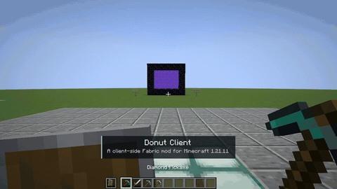](videos/01-intro.mp4)
[Watch the intro](videos/01-intro.mp4)

## Install

1. Install **Fabric Loader** for Minecraft 1.21.11.
2. Install **Fabric API** 0.141.4 or newer for 1.21.11.
3. Copy `donut-client-3.0.jar` into your Minecraft `mods` folder.
4. Start the game and press **Right Shift** in a world.

To build the jar yourself, run `./gradlew build` with JDK 21 (on Windows, `.\gradlew.bat build`). The jar appears in `build/libs/`.

## The menu

Press **Right Shift** to open or close it. Esc and the × also close it.

[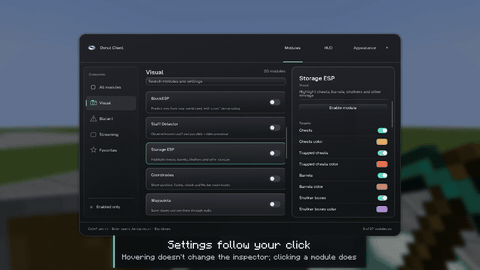](videos/02-menu.mp4)
[Watch: the menu](videos/02-menu.mp4)

**Layout.** Categories on the left (All modules, Visual, Blatant, Streaming, Favorites), module tiles in the middle and the settings inspector on the right. The footer shows shortcut hints and how many modules are on.

**Using it:**

- **Click a tile** (or right-click it) to open that module's settings, keybind and Favorite toggle in the inspector. Hovering does nothing. The inspector stays empty until you pick a module.
- **The switch on a tile** turns the module on or off without opening it.
- **Search** (or **Ctrl+F**) looks across every category and also matches setting names: "tracer" finds every module with a tracer option. Each result says which setting matched. **Enter** opens the top result, and **Esc** clears the search.
- **Enabled only** (bottom left) lists only modules that are on.
- **Favorites:** turn on **Favorite** in a module's inspector and it appears under Favorites.
- **Keybinds:** in the inspector, click **Keybind** and press a key (Delete or Backspace clears it, Esc cancels). A **!** means another control uses the same key. The same bindings are under Options → Controls → Donut Client.

**HUD tab:** the module list on/off, **Panel size** for every in-game panel, and the Progress Bar position editor.

**Appearance tab:**
- accent colour presets and a custom accent;
- corner radius, background dim, UI scale and **HUD panel size**;
- animation speed, frosted glass on or off, and optional ambient particles (off by default);
- panel, card and tab-bar colours and opacity;
- settings profiles (see [Settings profiles](#settings-profiles)).

## In-game panels (HUD)

Every Donut panel shares one compact style: the module list (top right), Coordinates, Storage ESP, BlockESP, Staff Detector, Auto Miner, Durability Alert, the Freecam readout, AutoBuilder progress and waypoint labels.

- **Size:** they're sized from your window, not Minecraft's GUI scale, so a big GUI scale doesn't make them huge. **HUD → Panel size** (60–160%) scales them all.
- **Layout:** panels in the same corner stack instead of overlapping, and bottom panels move up to stay clear of the hotbar.
- **Hiding:** they hide with F1, while menus are open, and with Donut's HUD switch.

---

## Visual tools

### Coordinates

[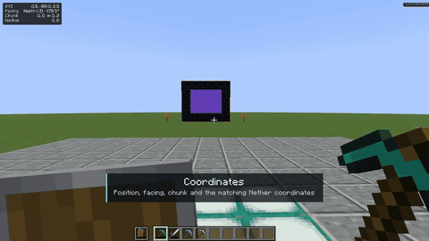](videos/03-coordinates.mp4)
[Watch: Coordinates](videos/03-coordinates.mp4)

A small panel with your position, facing direction and angle, chunk (and position inside it), and the matching Nether or Overworld coordinates (8:1). It can also show your biome and, while Freecam is on, the camera's position.

- **Where:** Visual → Coordinates.
- **Settings:** each line on or off, and top-left or bottom-right placement.
- It hides while F3 is open.

More: [quality-of-life guide](qol-features.md#coordinates-visual)

### Storage ESP

[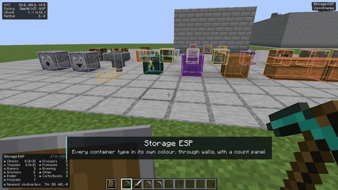](videos/04-storage-esp.mp4)
[Watch: Storage ESP](videos/04-storage-esp.mp4)

Outlines storage through walls, each type in its own colour: chests, trapped chests, barrels, shulker boxes, ender chests, hoppers, droppers and dispensers, furnaces, brewing stands, crafters/pots/chiseled bookshelves, and chest or hopper minecarts and chest boats. Double chests are one box and count once.

- **Where:** Visual → Storage ESP.
- **Panel:** a two-column count of each type, plus the nearest target with its distance and coordinates.
- **Settings:**
  - a toggle and colour for each type;
  - range (16–512 blocks);
  - how many of the nearest targets to show;
  - opacity, tracers, and the panel on or off.
- **Limits:** it only knows about chunks your game has received, so the server's view distance is the real range. Scanning is spread over several ticks so it never stutters.

More: [Storage ESP guide](storage-esp.md)

### Waypoints

[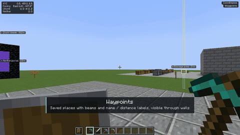](videos/05-waypoints.mp4)
[Watch: Waypoints](videos/05-waypoints.mp4)

Saved places, shown through walls as a beam, a block outline and a "name · distance" label.

- **Where:** Visual → Waypoints → **Manage waypoints**, or the **Open waypoints** and **Add waypoint here** shortcuts (unbound by default).
- **Adding:** at your position, at Storage ESP's nearest target, or at the group Base Finder is inspecting.
- **Managing:** rename, recolour (8 presets), hide and delete.
- **Storage:** waypoints are saved per server, or per singleplayer world (by its save folder), and per dimension. The limit is 500 in total. With **Show Nether / Overworld waypoints converted**, Overworld waypoints also appear in the Nether at 1/8 of their position, and the other way round.
- Labels follow view bobbing, so they stay on their beams while you walk.

More: [quality-of-life guide](qol-features.md#waypoints-visual)

### Freecam

[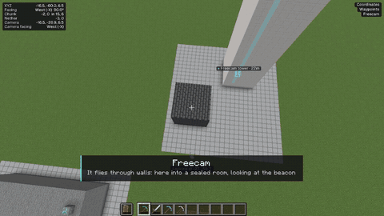](videos/06-freecam.mp4)
[Watch: Freecam](videos/06-freecam.mp4)

A detached camera. Your player stays exactly where it is and the server sees nothing move.

- **Where:** Visual → Freecam, default key **F6**.
- **Controls:**
  - WASD to move, Space up, Shift down;
  - Sprint for a speed boost;
  - the scroll wheel changes speed (0.1–10 blocks per tick), with a short readout;
  - the mouse looks around.
- **Settings:**
  - **Smoothing** (eases starting and stopping);
  - **Resume last camera position**;
  - **Follow nearest player** (with a range);
  - **Look at target**, which keeps the camera facing a block you choose.
- **Turns itself off** on death, dimension change and disconnect. It pauses while a menu is open.
- **Limits:** you only see chunks loaded around your real player.

More: [Freecam guide](freecam.md)

### Zoom

[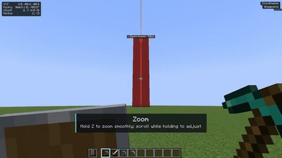](videos/07-zoom.mp4)
[Watch: Zoom](videos/07-zoom.mp4)

Hold **Z** to zoom (default 4×, 1.5–50×). Scroll while holding to adjust; your hotbar doesn't change.

- **Where:** Visual → Zoom (turn the module on first). The key is "Zoom (hold)" in Controls.
- **Settings:**
  - smooth transition;
  - scroll to adjust;
  - remember the scrolled level;
  - lower mouse sensitivity while zoomed.
- Your hand keeps its normal size. Zoom doesn't work while Freecam is on.

### Durability Alert

[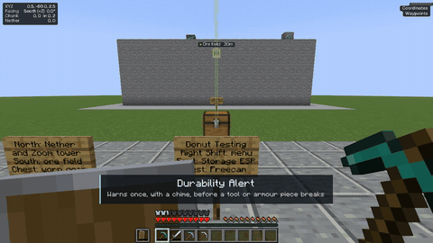](videos/08-durability-alert.mp4)
[Watch: Durability Alert](videos/08-durability-alert.mp4)

A card under the crosshair lists any held item or armour piece at or below a threshold (default 10%), with its icon, percentage and uses left. A short chime plays once per item, only for you.

- **Where:** Visual → Durability Alert.
- **Settings:** threshold (1–50%), include armour, include offhand, chime on or off.

### BlockESP (seed ore predictor)

[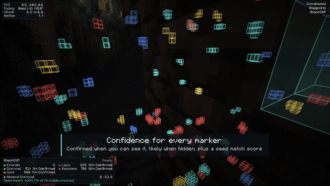](videos/16-blockesp-predictor.mp4)
[Watch: BlockESP seed predictor](videos/16-blockesp-predictor.mp4)

Predicts where ores originally generated, from the **world seed** you enter. It covers coal, copper, iron, gold, redstone, lapis, diamond and emerald, in stone and deepslate forms. It rebuilds the original vanilla 1.21.11 terrain in a private background generator. It never asks the server for anything.

- **Where:** Visual → BlockESP. Enter the seed with **Edit world seed**.
- **Confidence on every marker:**
  - **Confirmed (100%):** your game received that exact ore at that spot.
  - **Likely:** it's hidden in rock (a server's anti-xray may be disguising it).
  - **Unverified:** that chunk hasn't been received yet.
  - **Hidden:** your game received air there, so it has been mined.
  - **Seed match:** checks every predicted ore you can actually see (touching air, which anti-xray can't hide). It says, for example, "Seed match 99% (92 of 93 visible checked)", and warns when the seed or game version probably doesn't match.
- **Settings:**
  - per-ore toggles and colours;
  - stone and deepslate variant filters;
  - prediction radius (1–8 chunks);
  - minimum confidence, and fade by confidence;
  - opacity, tracers, and the panel on or off.
- **Limits:**
  - It only matches chunks generated by the same game version.
  - Custom world generation and player changes make predictions differ.
  - About 2–3% of ores near features that cross chunk borders can differ even with the right seed.

More: [BlockESP guide](blockesp.md)

### Base Finder

[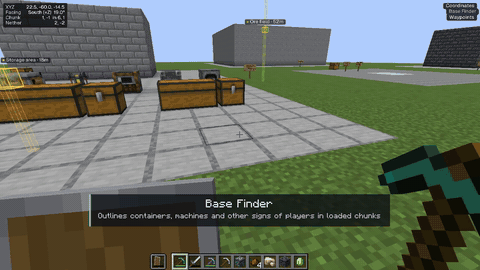](videos/17-base-finder.mp4)
[Watch: Base Finder](videos/17-base-finder.mp4)

Flags signs that players have been in an area, using only loaded chunks: containers, machines, redstone, spawners, armour stands and item frames, grown kelp, vines, cave vines and bamboo, bee nests, amethyst formations and light anomalies. Each category has its own toggle and colour.

- **Where:** Visual → Base Finder.
- **Methods:** **Classic** (clue scoring across neighbouring chunks), **ANBS+ Scan** (block-light anomalies) and **Activity clues**.
- **Look-to-inspect panel:** look at a group to see inventory icons and counts, or formation details.
- **Limits:** natural growth and generated structures are clues, not proof.

More: [Base Finder port notes](spectre-base-finder-port.md)

### Amethyst Scanner

*(No clip: the test worlds have no geode in view.)* Finds amethyst geodes from the block palette the server sent (**Bypass**), hidden-bud lighting (**Light**) or a light signature (**ANBS+ Scan**). It draws purple markers, with optional tracers. Palette hints are approximate.

More: [Amethyst port notes](spectre-amethyst-port.md)

### Light Debug

[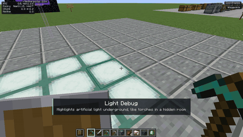](videos/14-light-debug.mp4)
[Watch: Light Debug](videos/14-light-debug.mp4)

Highlights block light underground (below Y 0) that is brighter than skylight would explain, such as torches in a hidden room.

- **Settings:** render radius (1–16 chunks), minimum light (1–15), denoise, highlight colour and opacity.

### Fullbright

[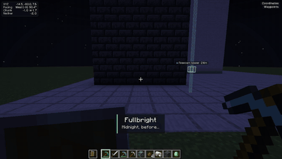](videos/10-fullbright.mp4)
[Watch: Fullbright](videos/10-fullbright.mp4)

Makes everything fully lit on your screen. It doesn't place light sources or change the world. Turn it off to return to your normal brightness.

### Staff Detector

[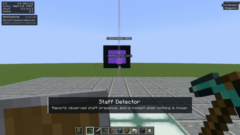](videos/15-staff-detector.mp4)
[Watch: Staff Detector](videos/15-staff-detector.mp4)

Watches for known staff (add names or UUIDs under **Staff list / evidence**), players reported in spectator mode, nearby invisible entities and, optionally, repeated `/msg` completion differences. It is deliberately honest: the panel always notes that hidden presence can't be known for sure.

More: [Staff Detector guide](staff-detector.md)

### Sound Detector

*(No clip: it needs other players or machines acting near you.)*

Watches sounds and events your game receives: containers, pistons, note blocks, mining, damage and explosions. It shows a Warning or Critical card with direction, distance, height, repeat count and the reason.

- **Presets:** Balanced activity, Players only, Base activity and Diagnostics.
- **Rules and areas:** custom rules, expected areas, per-server profiles, history and evidence export.
- Natural sounds, mobs and your own actions are filtered out by default. It never requests distant sounds.

More: [implementation plan](sound-detector-implementation-plan.md)

---

## Blatant tools

### Auto Miner

[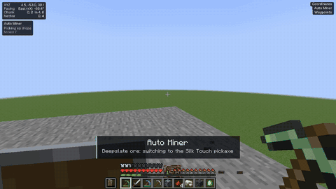](videos/09-auto-miner.mp4)
[Watch: Auto Miner](videos/09-auto-miner.mp4)

Finds ores in the chunks your game already has, walks to them, mines them and picks up the drops. It only uses ordinary actions: it turns your real view at a human pace (smoothed every frame), uses normal reach and mining speed, and never teleports or sends custom packets.

- **Where:** Blatant → Auto Miner. It starts off and never turns itself back on.
- **What it mines:**
  - Pick ores from the list (default diamond, iron, gold, emerald, ancient debris).
  - **Stone variants** and **Deepslate variants** choose which form.
  - By default it only mines **exposed** ores, the ones you could see. **Include buried ores** lets it dig a 1×2 staircase tunnel to hidden ones. It clears gravel and sand that fall in, and never digs straight down.
- **Tools** (hotbar only, in this order):
  - a **Silk Touch** pickaxe for deepslate ores (configurable), so the ore block itself drops;
  - a **Fortune** pickaxe for ores Fortune multiplies;
  - otherwise the fastest pickaxe, counting Efficiency;
  - tools at or below the **Tool reserve** uses are protected and never used.
- **Pick up drops:** after each ore it walks over that ore's drops (into the hole if needed) for up to 5 seconds.
- **Safety:**
  - **Pauses** when a menu is open, when Freecam is on and at low health. It also hands control back the moment you press a movement key, then resumes about 2 seconds after you stop.
  - **Skips** ores next to lava or water, and anything that would mean a fall of more than 3 blocks.
  - **Stops** when your inventory is full, and on death, dimension change or disconnect.
- **Warning:** automated mining is against the rules on many servers. Check first.

More: [Auto Miner guide](auto-miner.md)

### Fly

[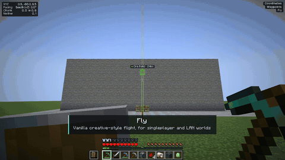](videos/11-fly.mp4)
[Watch: Fly](videos/11-fly.mp4)

Vanilla creative-style flight. In singleplayer and LAN worlds you host, it grants your player real flight, even in Survival. On remote servers it uses ordinary flight movement, which server permissions and movement checks may block or correct.

- **Controls:** Jump to rise, Sneak to descend, Sprint to fly faster.
- It turns off on death, dimension change and disconnect.

### AutoBuilder

*(No clip: it needs a schematic file.)*

Builds `.litematic` and `.schem` schematics.

1. Put the files in `schematics/donut/` (use **Open Folder**, then **Refresh**).
2. Select a file and inspect the model.
3. Set the position, rotation and mirroring.
4. Check **Materials**, then press **Start**.

- **Show in world** shows a ghost preview. **Place in world** lets you aim it: **R** rotates, **Page Up/Down** raises or lowers it, **Enter** anchors it.
- **Engines:** **Spectre Creative** for Creative singleplayer, or **Survival / multiplayer**, which walks, picks materials and uses ordinary placement.

More: [AutoBuilder guide](../AUTOBUILDER.md)

---

## Streaming tools

### Hotbar privacy and Name Hider

[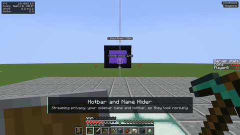](videos/12-hotbar-and-name-hider.mp4)
[Watch: Hotbar and Name Hider](videos/12-hotbar-and-name-hider.mp4)

- **Hotbar** blurs your item icons, counts, offhand slot and the selected item's name (blur 0–140%, default 90%). **Hide held items** shows an empty hand instead.
- **Name Hider** hides your username in the sidebar scoreboard. **Blur entire scoreboard** blurs the whole sidebar instead.

Both only change what your screen shows. The server and other players see everything as normal.

### Progress Bar

[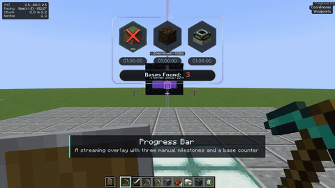](videos/13-progress-bar.mp4)
[Watch: Progress Bar](videos/13-progress-bar.mp4)

A stream overlay with three hexagons (Overworld, Nether, End) that you mark as you progress, plus a "Bases Found" counter.

- **Countdowns:** each hexagon has its own countdown (HH:MM:SS, with Start, Pause, Resume and Reset).
- **Placement and size:** move it with **Move overlay** and resize it (50–200%). The shiny outline is optional.

---

## Every key and shortcut

| Key | What it does |
| --- | --- |
| **Right Shift** | Open or close the Donut menu |
| **F6** | Freecam on/off |
| Hold **Z** | Zoom (Zoom module on) |
| **Ctrl+F** (menu) | Search |
| **Enter** (search) | Open the top result |
| **Esc** (menu) | Clear search, close pop-ups, close the menu |
| **Page Up/Down, Home/End** (menu) | Scroll |
| **Tab / Shift+Tab, Enter/Space, ←/→** (menu) | Keyboard navigation and slider steps |
| **R, Page Up/Down, Enter** | AutoBuilder placement: rotate, raise/lower, anchor |
| Unbound by default | Every other module toggle, plus Open waypoints, Add waypoint here, Acknowledge sound alert, Mute sound alerts and Sound activity history. Set them in a module's inspector or in Options → Controls → Donut Client |

Donut has **no chat commands**. Everything is in the menu.

## Settings profiles

**Appearance → Profiles → Export / import settings** saves every Donut setting and shortcut to a JSON file in `config/donut-profiles/`.

- **Exporting:** **Export current settings** writes the file, and **Open folder** shows it.
- **Importing:** select a profile to see a summary, then **Import selected** → **Confirm import**.
- **Safety:** importing backs up your current settings first and never turns modules on or off.
- **Before sharing:** profiles can contain server-specific data (waypoints, staff lists), so check one before sending it to anyone.

## Testing grounds

A ready-made singleplayer world with an area for each tool. It's used for play-testing and for the clips above.

- **Build it:** `./gradlew runClientGameTest -PtestingGroundsOnly=true` creates `run/saves/donut-testing-grounds`.
- **Play it:** `./gradlew runClient --args="--quickPlaySingleplayer donut-testing-grounds"`.
- **Areas:**
  - **East:** every storage type, double chests, a closed hut and a buried stash.
  - **West:** a tall tower and a sealed room for Freecam.
  - **South:** an ore field with exposed and buried ores, deepslate variants, lava and water.
  - **North:** a Nether portal, and a red tower 150 blocks away for Zoom.
  - **Hub:** a chest of worn gear for Durability Alert.
  - **Hotbar:** a worn pickaxe, a Silk Touch pickaxe and an iron pickaxe.

More: [TESTING.md](../TESTING.md#testing-grounds-manual-play-testing)

## Developer tools

All of these need JDK 21. On this machine, set `JAVA_HOME` and `GRADLE_USER_HOME` as in TESTING.md.

| Command | What it does |
| --- | --- |
| `./gradlew build` | Builds the jar and runs the unit tests |
| `./gradlew runClientGameTest` | Runs every in-game test in real Minecraft windows |
| `-PgametestSkip=A,B` | Leaves named suites out of a full run |
| `-PautoMinerTestsOnly=true`, `-PstorageEspTestsOnly=true`, `-PqolTestsOnly=true`, `-PfreecamTestsOnly=true`, `-PblockEspTestsOnly=true` | Focused test suites |
| `-PuiPreviewOnly=true` | Screenshots of the HUD and menu at several sizes, for visual review |
| `-PtestingGroundsOnly=true` | Builds the testing-grounds world |
| `-PdemoReelOnly=true` | Records the clips in this guide and the full tour into `demo/` (needs ffmpeg) |

## Client-side only: what that means

- **Data:** Donut reads only what your game already has, meaning the chunks, entities, sounds and your own inventory that the server sent. It never asks the server for extra chunks.
- **Actions:** the automation (Auto Miner, AutoBuilder, Fly on servers) uses the same actions you could do by hand, at normal speed and reach. It sends no custom packets and never teleports.
- **Display-only modules:** Freecam, Zoom, Fullbright, the ESPs and the privacy modules only change what your screen shows.
- **Not hidden:** nothing is designed to hide from a server's anti-cheat. Servers set their own rules, and automation in particular is often not allowed.
